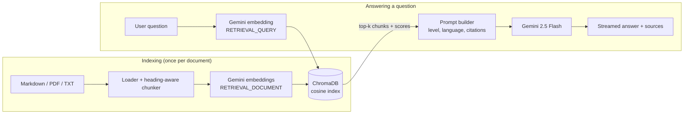

# DeutschBuddy: a RAG-Powered German Learning Assistant

*German project by Parth Khandelwal (23BDS0043), submitted to Dhananjay Kumar.*

DeutschBuddy is an AI tutor for learners of German. It uses **Retrieval-Augmented Generation (RAG)**: before the language model answers, the app searches a knowledge base of German grammar, vocabulary and culture notes, and gives the most relevant passages to the model. Answers are grounded in those passages and cite them, which reduces made-up answers (hallucinations).

## Features

| Feature | What it does |
|---|---|
| **Ask a question** | Chat in English or German. Answers adapt to your CEFR level (A1–C1), cite their sources, and handle follow-up questions. |
| **Sentence explainer** | Paste a German sentence: you get a translation, a word-for-word gloss, corrections, and an explanation of every word and grammar rule. |
| **Quiz** | Generates multiple-choice questions on any topic from the knowledge base, scores them and explains each answer. |
| **Knowledge base** | Upload your own PDFs, Markdown or text files (textbook chapters, word lists) and ask questions about them. |
| **Transparent retrieval** | Every answer shows the retrieved passages and their similarity scores. Top-k and the similarity threshold can be changed live. |

## Architecture



1. **Loading and chunking** ([rag/loader.py](rag/loader.py)): Markdown files are split by heading, then into ~900-character chunks with a 150-character overlap, on paragraph and sentence boundaries. Each chunk keeps its heading path (e.g. `The Four German Cases > Prepositions`) so it makes sense on its own. PDFs are chunked page by page, so citations can name the page.
2. **Embedding** ([rag/gemini.py](rag/gemini.py)): `gemini-embedding-001` is multilingual, so an English question finds German text and the other way round. Documents and queries use different task types (`RETRIEVAL_DOCUMENT` / `RETRIEVAL_QUERY`), and vectors are reduced to 768 dimensions and normalised.
3. **Vector store** ([rag/vectorstore.py](rag/vectorstore.py)): ChromaDB stores the vectors on disk with an HNSW cosine index. Chunk IDs are content hashes, so restarting the app does not embed the same text twice.
4. **Retrieval** ([rag/pipeline.py](rag/pipeline.py)): the top-k chunks above a minimum similarity are selected, optionally filtered by category. Short follow-up questions ("and in the plural?") are combined with the previous question before searching.
5. **Generation** ([rag/prompts.py](rag/prompts.py)): the prompt contains numbered passages and rules for the tutor (cite sources, adapt to the level, give articles with nouns). Quiz and sentence analysis use Gemini's structured JSON output with a fixed schema, so the UI can render them reliably.

## Project structure

```
German_project/
├── app.py                  Streamlit user interface (4 tabs)
├── rag/
│   ├── config.py           Settings from .env
│   ├── loader.py           File loading and chunking
│   ├── gemini.py           Gemini embedding + chat wrappers (with retry on rate limits)
│   ├── vectorstore.py      ChromaDB wrapper
│   ├── prompts.py          Prompt templates and JSON schemas
│   └── pipeline.py         The RAG pipeline (index, retrieve, ask, quiz, explain)
├── knowledge_base/
│   ├── grammar/            Articles, cases, verbs, word order, tenses, adjective endings
│   ├── vocabulary/         Food, family, travel, work and study, everyday phrases
│   └── culture/            Festivals, history, cities, everyday life, famous Germans
├── tests/test_pipeline.py  Offline tests (no API key needed)
├── requirements.txt
└── .env.example
```

## Setup guide

You need **Python 3.10 or newer** and a free **Gemini API key**.

### 1. Get a Gemini API key
Go to [Google AI Studio](https://aistudio.google.com/apikey), sign in with a Google account and click **Create API key**. The free tier is enough for this project.

### 2. Install
Open a terminal in the project folder:

```bash
python -m venv .venv
```

Activate it. On Windows (PowerShell):

```bash
.venv\Scripts\Activate.ps1
```

On macOS / Linux:

```bash
source .venv/bin/activate
```

Then install the packages:

```bash
pip install -r requirements.txt
```

### 3. Add your key
Copy `.env.example` to `.env` and paste your key:

```
GEMINI_API_KEY=your-key-here
```

### 4. Run

```bash
streamlit run app.py
```

The app opens at http://localhost:8501. The first start takes about a minute because all knowledge-base chunks are embedded; later starts are instant because the vectors are saved in `chroma_db/`.

### 5. Run the tests (optional)

```bash
python tests/test_pipeline.py
```

## Experiments: the DaF-GQA benchmark

The conference paper compares four configurations on 180 German grammar questions in [benchmark/dafgqa.jsonl](benchmark/dafgqa.jsonl):

| ID | Configuration | Retrieved passages | CEFR level instruction | Abstention rule |
|---|---|---|---|---|
| C1 | Closed-book | No | No | No |
| C2 | RAG | Yes | No | No |
| C3 | RAG + level | Yes | Yes | No |
| C4 | RAG + level + abstain | Yes | Yes | Yes |

Each benchmark line holds the question, its topic, CEFR level (A1/A2/B1), language (en/de/mixed), the gold knowledge-base heading(s) as `file.md#Heading`, and a reference answer. 160 questions are in scope; 20 cover topics the knowledge base does not contain (Konjunktiv II, passive, relative clauses, reflexive verbs, n-declension).

**Before running:** have a German teacher check the reference answers in the benchmark file.

Run the steps in order (each one can be stopped and restarted; finished work is skipped):

1. Generate 720 answers (180 questions × 4 configurations). `--delay` keeps within the free-tier rate limit; a full run takes about 1.5 hours.

   ```bash
   python experiments/run.py --delay 7
   ```

   Try it on a few questions first with `--ids CAS-04 TNS-05 OOS-01`.

2. Judge faithfulness and citation precision with an LLM, and create `judge_check_sample.csv` for a human to verify 20% of the verdicts.

   ```bash
   python experiments/judge.py --delay 7
   ```

3. Create the blind rating sheets for the two raters. Each rater fills `correctness` (correct / partly / incorrect) and `level_fit` (suitable / too_difficult / too_simple) in their own CSV. Keep `rating_key.csv` away from the raters.

   ```bash
   python experiments/sheets.py
   ```

4. After rating, put the agreed labels for disagreements in `ratings_final.csv` (same columns), then compute every table of the paper into `experiments/results/tables.md`:

   ```bash
   python experiments/score.py
   ```

All outputs go to `experiments/results/`. The tests in `tests/test_experiments.py` check the benchmark (180 questions, Table I counts, every gold heading exists in the knowledge base) and every script with a fake model.

## Configuration

All settings can be changed in `.env`:

| Variable | Default | Meaning |
|---|---|---|
| `GEMINI_MODEL` | `gemini-2.5-flash` | Model that writes the answers |
| `GEMINI_EMBED_MODEL` | `gemini-embedding-001` | Embedding model |
| `EMBED_DIM` | `768` | Embedding size (768, 1536 or 3072). Delete `chroma_db/` after changing it. |
| `CHUNK_SIZE` / `CHUNK_OVERLAP` | `900` / `150` | Chunk length and overlap in characters |
| `TOP_K` | `5` | Passages sent to the model |
| `MIN_SCORE` | `0.45` | Minimum cosine similarity for a passage to be used |

## Troubleshooting

- **"No Gemini API key found"**: check that the file is called `.env` (not `.env.txt`) and is in the project folder.
- **429 / quota errors**: the free tier limits requests per minute. The app retries automatically; wait a minute if it still fails.
- **"Model not found"**: Google renames models over time. Set `GEMINI_MODEL` to a current model from the [model list](https://ai.google.dev/gemini-api/docs/models).
- **A PDF adds 0 chunks**: scanned PDFs contain images, not text. Run OCR on them first.
- **Start over**: stop the app and delete the `chroma_db/` folder; it is rebuilt on the next start.

## Author

| | |
|---|---|
| Name | Parth Khandelwal |
| Registration number | 23BDS0043 |
| Course | German (B.Tech final-year project) |
| Faculty | Dhananjay Kumar |
| Repository | https://github.com/parth-05122005/DeutschBuddy |

## Ideas for extension

- Hybrid search: combine vector search with keyword search (BM25) for exact word lookups.
- Text-to-speech so learners can hear the pronunciation of examples.
- Track quiz scores over time and suggest topics to revise.
- Evaluate retrieval quality with a set of test questions (hit rate, MRR).
