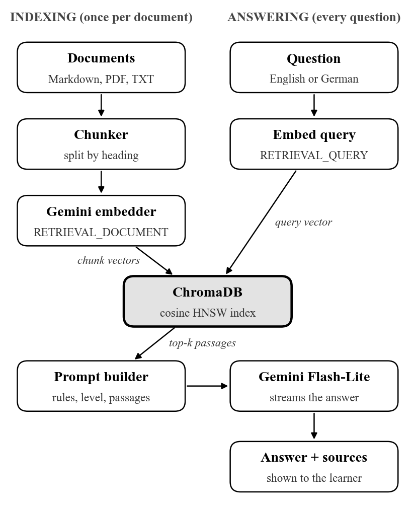

# Does Retrieval Make LLM Grammar Explanations Trustworthy? A Benchmark Study for German as a Foreign Language

@author Parth Khandelwal | [Department] | [Institution] | [City], India | [college email]
@author Dhananjay Kumar | [Department] | [Institution] | [City], India | [email]

## Abstract

Large language models (LLMs) can explain grammar on demand, but their explanations are often incomplete or wrong, and learners cannot check them. We study whether retrieval-augmented generation (RAG) over a small, teacher-curated grammar knowledge base makes LLM explanations more trustworthy for learners of German as a foreign language. We introduce DaF-GQA, a benchmark of 180 learner questions at CEFR levels A1–B1, each linked to the knowledge-base section that answers it, including 20 questions deliberately outside the knowledge base. Using DeutschBuddy, an open-source RAG tutor built on Gemini 3.5 Flash-Lite, multilingual Gemini embeddings and ChromaDB, we compare four configurations: closed-book generation, RAG, RAG with CEFR level control, and RAG with level control and an abstention rule. An LLM judge, validated against a German instructor on a blind sample, rates correctness against teacher-checked reference answers and level fit; we also measure retrieval hit rate, faithfulness and citation precision. The closed-book model was already strong: 95.0% of its explanations were fully correct, and retrieval raised this to 98.1%, a difference that was not statistically significant. Retrieval's clearer benefit was verifiability: grounded answers had a faithfulness of 0.987, 99.5% of their citations pointed to a supporting passage, and they were 45% shorter. CEFR level control did not weaken grounding, and a one-sentence abstention rule raised the share of flagged out-of-scope questions from 10% to 90% with one false refusal among 160 in-scope questions. We release the benchmark, code and annotations.

## Index Terms

retrieval-augmented generation, large language models, grammar explanation, German as a foreign language, CEFR, educational NLP

## I. Introduction

Learners of a foreign language increasingly turn to LLM chatbots for grammar help, but an explanation that sounds right is not necessarily right. LLMs offer personalised, always-available explanations [1], yet they also produce fluent statements that are unsupported or false, a behaviour known as hallucination [2]. For a beginner, a confident but wrong rule about case endings is worse than no answer, because the learner has no means to detect the error.

Recent work confirms this risk for grammar. With one-shot prompting, GPT-4 explained only about 40% of learner errors in German and Chinese; a multi-step pipeline was needed to reach high accuracy [3]. A 2026 evaluation of several LLMs on English learner errors found strong surface-level correction but explanations lacking "the terminological and domain knowledge that effective language teaching requires" [4]. Neither study supplies that knowledge to the model at generation time.

Retrieval-augmented generation [5] is the standard way to give a model such knowledge: before answering, the system retrieves passages from a trusted collection and asks the model to answer from them. For language teaching, the trusted collection can be a set of grammar notes written or checked by a teacher, and the retrieved passages can be shown to the learner as sources. Whether this actually improves grammar explanations has not been measured.

Two further questions arise in a learner-facing setting. First, learners need explanations at their proficiency level, defined by the Common European Framework of Reference (CEFR) [6]; controlling the level of LLM output is an open problem [7], and LLMs often write above beginner level [8], and simplifying an answer may pull it away from its sources. Second, a tutor should say when a question falls outside its material rather than answer from memory.

We address these gaps with three research questions:

- **RQ1:** Does retrieval from a curated grammar knowledge base improve the correctness of LLM grammar explanations compared with the same model without retrieval?
- **RQ2:** Does instructing the model to answer at the learner's CEFR level reduce faithfulness to the retrieved sources or the precision of its citations?
- **RQ3:** Does an explicit abstention rule make the system flag out-of-scope questions without harming in-scope answers?

Our contributions are:

1. **DaF-GQA**, a benchmark of 180 German grammar questions at A1–B1 with gold knowledge-base sections and teacher-checked reference answers, including 20 out-of-scope questions.
2. **DeutschBuddy**, an open-source RAG tutor for German with heading-aware chunking, cross-lingual retrieval and cited, level-adapted answers.
3. A **controlled comparison of four configurations** on correctness and level fit, rated by an LLM judge whose agreement with a German instructor we report, plus measures of retrieval, faithfulness and citation precision.

## II. Related Work

Prior work has studied grammar explanation, retrieval grounding and level control separately; no study combines them for a foreign-language learner.

### A. LLMs for Grammar Explanation

Song et al. [3] define grammar error explanation (GEE) as producing one natural-language explanation per learner error. One-shot GPT-4 explained only about 40% of errors and skipped 39.8%; a two-step pipeline that first extracts atomic edits and then explains each one reached 93.9% correct explanations for German, as judged by two German teachers. Šekrst and Kovačić [4] evaluated several LLMs on English learner errors with automatic metrics and expert judgments and concluded that explanations lack the domain knowledge of a teacher. Both studies rely on the model's internal knowledge; neither retrieves reference material.

### B. Retrieval-Augmented Generation and Its Evaluation

RAG conditions a generator on passages returned by a retriever [5]. Dense retrievers based on learned embeddings outperform keyword search for open-domain question answering [9], and later systems add query rewriting, re-ranking and modular pipelines [10]. RAGAS [11] evaluates RAG without reference answers: faithfulness checks whether each claim in an answer can be inferred from the retrieved context, and context precision and recall assess the retriever. Faithfulness does not verify that a specific inline citation points to the passage that supports the cited sentence, which matters when sources are shown to learners.

### C. CEFR-Controlled Generation

The CEFR describes six proficiency levels from A1 to C2 [6]. Malik et al. [7] compare prompting, fine-tuning and reinforcement learning for controlling the proficiency level of generated content, and Jin et al. [8] report that most LLMs write at near-native complexity unsuitable for A1–A2 learners, with controllable generation raising comprehensibility for beginners from 39.4% to 83.3%. Rabih et al. [12] show that CEFR-guided prompting with lexical constraints aligns Arabic generation with target levels far better than unconstrained prompting. These studies control level in free generation; they do not ask whether simplifying a grounded answer weakens its link to its sources.

### D. Chatbots in Second-Language Learning

A meta-analysis of 41 experimental studies found a moderate-to-large positive effect of generative-AI chatbots on second-language acquisition (effect size 0.576) [13], while warnings about unverified output persist [1]. None of the included studies evaluates a retrieval-grounded tutor.

### E. Positioning

Table: TABLE I | Comparison with Prior Work
| Work | Language | Retrieval | Level control | Sources shown | Expert rating |
| --- | --- | --- | --- | --- | --- |
| Song et al. [3] | German, Chinese | No | No | No | Yes |
| Šekrst and Kovačić [4] | English | No | No | No | Yes |
| Malik et al. [7], Jin et al. [8] | English, Japanese | No | Yes | No | Varies |
| RAGAS [11] | General | Yes | No | No | No |
| **This work** | **German** | **Yes** | **Yes** | **Yes** | **Sample** |

## III. System: DeutschBuddy

DeutschBuddy is a RAG tutor with an indexing pipeline and an answering pipeline that share one vector index (Fig. 1).

### A. Knowledge Base

The knowledge base consists of 16 Markdown documents written for German learners at A1–B1: six on grammar (articles and gender, the four cases, present-tense conjugation, word order, tenses, adjective endings), five on themed vocabulary and five on German culture. Explanations are in English, examples in German with translations, nouns always carry their article and plural, and paradigms such as article declension are given as tables. Only the grammar documents are used in this study.

### B. Indexing

Documents are split by Markdown heading, then into chunks of at most about 900 characters on paragraph and sentence boundaries, with a 150-character overlap. The full heading path is prepended to each chunk (e.g. *The Four German Cases (Kasus) > Prepositions and their cases > Always Dativ*) so that short chunks such as a preposition list remain interpretable. With these settings the knowledge base yields 123 chunks. Chunks are embedded with the multilingual gemini-embedding-001 model [14] using the RETRIEVAL_DOCUMENT task type, reduced to 768 dimensions, L2-normalised and stored in ChromaDB with an HNSW cosine index [15]. Chunk identifiers are content hashes, so re-indexing is idempotent.

### C. Answering

A question is embedded with the RETRIEVAL_QUERY task type. Because the embedding space is shared across languages, English, German and mixed questions retrieve the same German examples. The top-k chunks (k = 5) with cosine similarity of at least 0.45 are numbered and inserted into the prompt. Short follow-up questions are concatenated with the previous question before retrieval. The system prompt instructs Gemini 3.5 Flash-Lite to cite passages as [1], [2], to give nouns with their articles, to show German examples with translations, and, depending on the configuration, to answer at a target CEFR level and to state when the passages do not contain the answer.

The system is implemented in Python with Streamlit and is released as open source.

## IV. Benchmark and Experimental Setup

### A. The DaF-GQA Benchmark

DaF-GQA (German as a Foreign Language Grammar Question Answering) contains 180 questions written in the form learners ask them. 160 in-scope questions are answerable from the grammar knowledge base; each is labelled with its CEFR level, its topic, the gold knowledge-base section(s) that answer it, and a reference answer checked by the second author, a German instructor. 20 out-of-scope questions cover topics deliberately absent from the knowledge base (Konjunktiv II, passive voice, relative clauses, reflexive verbs, n-declension).

Table: TABLE II | Composition of DaF-GQA by Topic and CEFR Level
| Topic | A1 | A2 | B1 | Total |
| --- | --- | --- | --- | --- |
| Articles and gender | 15 | 10 | 0 | 25 |
| Cases and prepositions | 10 | 10 | 10 | 30 |
| Verb conjugation | 15 | 10 | 5 | 30 |
| Word order | 10 | 10 | 5 | 25 |
| Tenses | 10 | 10 | 10 | 30 |
| Adjective endings | 0 | 10 | 10 | 20 |
| **In-scope total** | **60** | **60** | **40** | **160** |
| Out-of-scope | – | – | – | 20 |

To reflect real learner input, 106 questions are written in English ("Why is it *das Mädchen* and not *die Mädchen*?"), 43 in German ("Welcher Fall kommt nach *ohne*?") and 31 mix both ("Ich fahre mit ___ Bus, *dem* or *den*?"). The language of each question is recorded for analysis.

### B. Configurations

All configurations use Gemini 3.5 Flash-Lite at temperature 0.2 with the same base tutor prompt; only the listed components change. Retrieval is restricted to the grammar documents, with k = 5 and a minimum cosine similarity of 0.45.

Table: TABLE III | Experimental Configurations
| ID | Configuration | Retrieved passages | CEFR instruction | Abstention rule |
| --- | --- | --- | --- | --- |
| C1 | Closed-book | No | No | No |
| C2 | RAG | Yes | No | No |
| C3 | RAG + level | Yes | Yes | No |
| C4 | RAG + level + abstain | Yes | Yes | Yes |

C1 vs C2 answers RQ1, C2 vs C3 answers RQ2, and C3 vs C4 answers RQ3.

### C. Metrics

- **Correctness** (RQ1): the judge rates each answer *correct*, *partly correct* (key point right but incomplete or with a minor error) or *incorrect* against the reference answer.
- **Retrieval Hit@5 and MRR**: whether a gold section appears among the five retrieved chunks, and the reciprocal rank of the first gold chunk.
- **Faithfulness** (RQ2): the share of answer claims supported by the retrieved context, following the RAGAS definition [11]: an LLM judge at temperature 0 splits the answer into factual claims and checks each against the retrieved passages.
- **Citation precision** (RQ2): the share of inline citations whose passage supports the sentence it is attached to, as judged by the LLM judge.
- **Level fit** (RQ2): the judge rates whether an explanation is *suitable*, *too difficult* or *too simple* for the question's CEFR level.
- **Abstention** (RQ3): precision and recall of flagging out-of-scope questions, and the false-abstention rate on in-scope questions.

### D. LLM Judge and Its Validation

All judgments are made by Gemini 3.1 Flash-Lite at temperature 0, a different model from the one being evaluated, with a fixed rubric and a schema-constrained output. For each of the 640 in-scope answers (160 questions × 4 configurations) the judge sees the question, its CEFR level, the teacher-checked reference answer, the retrieved passages (C2–C4) and the answer, and returns correctness, level fit, the answer's claims and its citations in one call. To validate the judge, the second author rated a blind random sample of 50 answers without seeing the judge's labels; agreement is reported as Cohen's κ [16]. Differences in the proportion of correct answers between paired configurations are tested with McNemar's test [17] at α = 0.05.

## V. Results

### A. Correctness (RQ1)

Table: TABLE IV | Results on the 160 In-Scope Questions
| Config. | Correct (%) | Partly (%) | Incorrect (%) | Faithful. | Cit. prec. (%) | Level fit (%) |
| --- | --- | --- | --- | --- | --- | --- |
| C1 Closed-book | 95.0 | 5.0 | 0.0 | – | – | 100 |
| C2 RAG | 98.1 | 1.9 | 0.0 | 0.987 | 99.5 | 100 |
| C3 RAG + level | 99.4 | 0.6 | 0.0 | 0.987 | 99.8 | 100 |
| C4 RAG + level + abstain | 96.9 | 3.1 | 0.0 | 0.988 | 99.3 | 100 |

Judge–instructor agreement on the 50-answer sample: correctness κ = [XX], level fit κ = [XX].

No answer in any configuration was rated incorrect. Retrieval raised the share of fully correct explanations from 95.0% (C1) to 98.1% (C2): 8 questions improved and 3 got worse, which is not significant (McNemar exact p = 0.23). The closed-book errors were slips inside otherwise sound explanations: a wrongly conjugated example (*Ich könne* for *ich kann*), a non-existent accusative form (*keins*), an answer that first gave the wrong article and then corrected itself, and a list of accusative prepositions with an ungrammatical example. Errors that remained with retrieval were additions not found in the passages, such as a wrong gender for *der Tisch* (written *das Tisch*) and an invented etymology for *groß*. Grounded answers were also shorter: 111 words on average in C2 against 201 in C1.

### B. Retrieval Quality

Table: TABLE V | Retrieval Quality by Question Language
| Question language | n | Hit@5 | MRR |
| --- | --- | --- | --- |
| English | 96 | 1.000 | 0.977 |
| German | 38 | 1.000 | 0.890 |
| Mixed | 26 | 1.000 | 0.949 |
| **All in-scope** | **160** | **1.000** | **0.952** |

A gold section was among the five retrieved chunks for every in-scope question, so the remaining C2 errors are not caused by retrieval misses. German questions ranked the gold section first less often (MRR 0.890) than English ones (0.977), and mixed questions fell in between. With only six grammar documents, retrieval is close to its ceiling; a larger collection would be a harder test. The median time to the first streamed token was 1.8 s closed-book and 2.7 s with retrieval, which includes embedding the question and searching the index.

### C. Level Control vs Grounding (RQ2)

Adding the CEFR instruction did not weaken grounding: faithfulness stayed at 0.987 and citation precision moved from 99.5% to 99.8%, while fully correct answers rose slightly from 98.1% to 99.4% (p = 0.63). Across the three grounded configurations, 22 of 480 answers contained at least one claim the judge could not find in the passages. The judge rated every answer in every configuration as suitable for its level, including closed-book answers that did not receive the learner's level, so level fit as measured here could not distinguish the configurations. Whether this reflects lenient judging or genuinely accessible answers is a question for the instructor's spot-check.

### D. Abstention (RQ3)

Table: TABLE VI | Abstention on 20 Out-of-Scope and 160 In-Scope Questions
| Config. | Out-of-scope flagged (%) | Precision | False abstentions (%) |
| --- | --- | --- | --- |
| C1 Closed-book | 0.0 | – | 0.0 |
| C2 RAG | 15.0 | 1.000 | 0.0 |
| C3 RAG + level | 10.0 | 1.000 | 0.0 |
| C4 RAG + level + abstain | 90.0 | 0.947 | 0.6 |

Without an explicit rule, the tutor rarely signalled that a question lay outside its notes: the closed-book model never did, and the RAG configurations did so for 2–3 of the 20 out-of-scope questions, usually by stating that the passages did not cover the topic. The abstention rule (C4) raised this to 18 of 20, with one false refusal among the 160 in-scope questions (precision 0.947). In C4 the tutor still answered after the warning, so the rule labels unsourced answers rather than withholding help, and fully correct answers fell by 2.5 points relative to C3, which is not significant (p = 0.13).

## VI. Discussion and Limitations

**What retrieval changes.** For core A1–B1 grammar, a current LLM is already right most of the time without retrieval, so the correctness gain is small and not significant on 160 questions. What retrieval adds is a way to check the answer: almost every claim can be traced to a teacher's note, and the citation shows which one. For a learner who cannot judge a grammar explanation alone, this matters more than a few points of accuracy. The errors that remained with retrieval were content the model added beyond the passages, which suggests instructing the model to stay within them more strictly.

**Level control and abstention.** Asking for the learner's level did not cost grounding. Signalling the limits of the knowledge base did not happen by default and required an explicit rule, which worked well at almost no cost to in-scope answers.

**Implications for teaching.** Showing learners the passage behind each explanation turns the tutor into something a teacher can audit. A small knowledge base written by the teacher defines what the tutor knows, so the curriculum, not the model's pretraining, sets the content.

**Limitations.** The knowledge base covers six grammar topics at A1–B1 and the benchmark has 180 questions, so results may not hold for advanced grammar or larger collections. All configurations use one model, Gemini 3.5 Flash-Lite; other LLMs may benefit more or less from retrieval. Questions are written by the authors in learner style rather than collected from real learners. Results are near the ceiling: correctness is high in every configuration and retrieval found the gold section for every question, which limits statistical power; harder grammar and a larger knowledge base are needed to separate the configurations. All ratings come from one LLM judge, validated against a single instructor on 50 answers. The judge rated every answer as suitable for its level, so level fit needs human or finer-grained measurement, and a judge may share blind spots with the model it evaluates.

## VII. Conclusion and Future Work

We asked whether retrieving a teacher-curated grammar knowledge base makes LLM grammar explanations trustworthy for learners of German. We introduced the DaF-GQA benchmark and the open-source DeutschBuddy tutor, and compared closed-book generation with three retrieval-based configurations. Retrieval raised fully correct explanations from 95.0% to 98.1%, a gain that was not significant because the closed-book model was already strong; its main benefit was that answers became shorter, grounded (faithfulness 0.987) and correctly cited (99.5%). CEFR level control did not weaken grounding, and a one-sentence abstention rule raised the share of flagged out-of-scope questions from 10% to 90%. For grammar tutoring, the value of RAG lies less in making a strong model more accurate than in making its explanations checkable.

Future work will (i) collect real learner questions from German courses, (ii) extend the approach to explaining errors in learner writing using the MERLIN corpus of CEFR-rated German exam texts [18], (iii) test hybrid keyword-and-vector retrieval for mixed-language questions, and (iv) measure learning gains in a classroom study.

## References

1. E. Kasneci *et al.*, "ChatGPT for good? On opportunities and challenges of large language models for education," *Learning and Individual Differences*, vol. 103, 2023.
2. Z. Ji *et al.*, "Survey of hallucination in natural language generation," *ACM Computing Surveys*, vol. 55, no. 12, 2023.
3. Y. Song, K. Krishna, R. Bhatt, K. Gimpel, and M. Iyyer, "GEE! Grammar error explanation with large language models," in *Findings of the Association for Computational Linguistics: NAACL 2024*, 2024.
4. K. Šekrst and A. Kovačić, "Clause encounters of the third kind: Can LLMs replace language teachers?" arXiv:2608.16286, 2026.
5. P. Lewis *et al.*, "Retrieval-augmented generation for knowledge-intensive NLP tasks," in *Advances in Neural Information Processing Systems (NeurIPS)*, 2020.
6. Council of Europe, *Common European Framework of Reference for Languages: Learning, Teaching, Assessment – Companion Volume*. Strasbourg: Council of Europe Publishing, 2020.
7. A. Malik, S. Mayhew, C. Piech, and K. Bicknell, "From Tarzan to Tolkien: Controlling the language proficiency level of LLMs for content generation," in *Findings of the Association for Computational Linguistics: ACL 2024*, 2024.
8. M. Jin, L. Dugan, and C. Callison-Burch, "Toward beginner-friendly LLMs for language learning: Controlling difficulty in conversation," in *Proc. EACL*, 2026.
9. V. Karpukhin *et al.*, "Dense passage retrieval for open-domain question answering," in *Proc. EMNLP*, 2020.
10. Y. Gao *et al.*, "Retrieval-augmented generation for large language models: A survey," arXiv:2312.10997, 2023.
11. S. Es, J. James, L. Espinosa-Anke, and S. Schockaert, "Ragas: Automated evaluation of retrieval augmented generation," arXiv:2309.15217, 2023.
12. N. Rabih, C. Qwaider, and T. Briscoe, "Can LLMs control readability? A multi-dimensional evaluation framework for CEFR-controlled Arabic generation," in *Proc. READIxTSAR Workshop, LREC*, 2026.
13. M. Li, Y. Wang, and X. Yang, "Can generative AI chatbots promote second language acquisition? A meta-analysis," *Journal of Computer Assisted Learning*, 2025, doi: 10.1111/jcal.70060.
14. J. Lee *et al.*, "Gemini Embedding: Generalizable embeddings from Gemini," arXiv:2503.07891, 2025.
15. Y. A. Malkov and D. A. Yashunin, "Efficient and robust approximate nearest neighbor search using hierarchical navigable small world graphs," *IEEE Trans. Pattern Anal. Mach. Intell.*, vol. 42, no. 4, 2020.
16. J. Cohen, "A coefficient of agreement for nominal scales," *Educational and Psychological Measurement*, vol. 20, no. 1, 1960.
17. Q. McNemar, "Note on the sampling error of the difference between correlated proportions or percentages," *Psychometrika*, vol. 12, no. 2, 1947.
18. A. Boyd *et al.*, "The MERLIN corpus: Learner language and the CEFR," in *Proc. LREC*, 2014.
